<h1 align="center">LiquidTube</h1>

<p align="center">
  A native Android music player with an iOS&nbsp;26 "Liquid Glass" look, built on top of YouTube Music.<br>
  Kotlin · Jetpack Compose · Media3
</p>

<p align="center">
  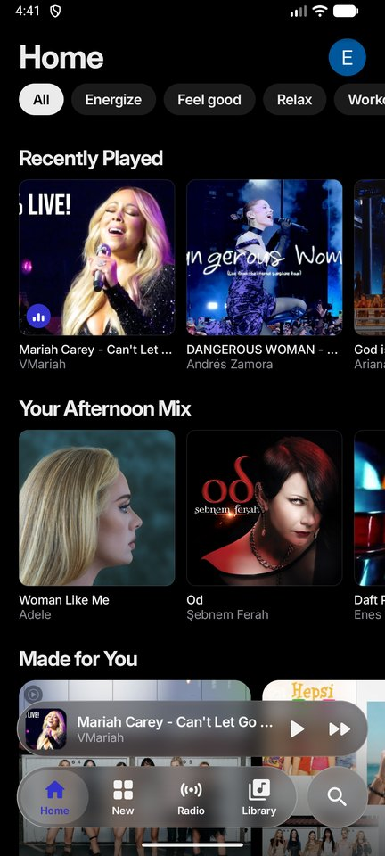
  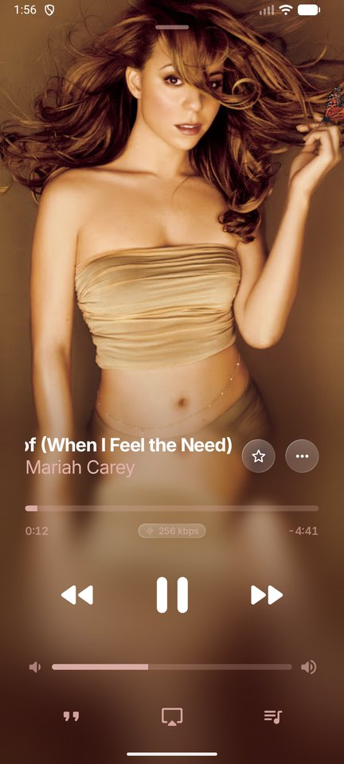
  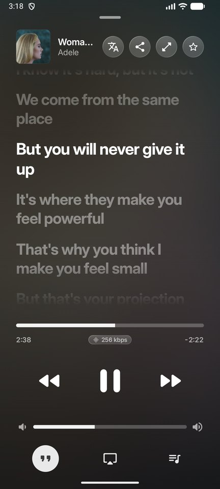
  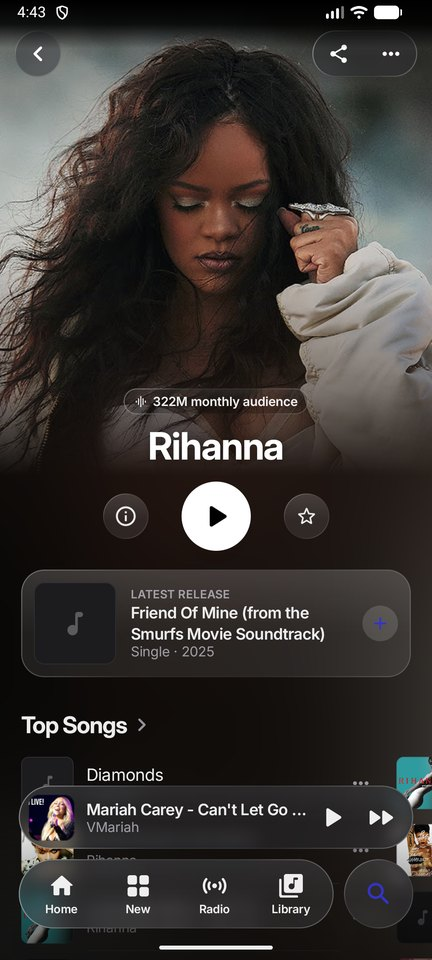
</p>

> A personal project, not affiliated with Apple, Google or YouTube. You sign in with
> your own YouTube Music account; Premium features use your own Premium subscription.

---

## ✨ Features

### 🎧 Now Playing
Full-bleed artwork that melts into a progressive blur, an accent colour taken from the
cover, and a player that springs open from the mini-player.

- **Synced lyrics, word by word.** Tap a line to jump to it; hold it to share a lyric card.
- **Lyric translations.** A translation under every line, in the language you pick.
- **Queue.** Drag to reorder (it scrolls when you reach the edge), swipe to remove with
  **Undo**, and a **History** of what already played.
- **256 kbps Premium audio**, crossfade, equalizer, Sound Check, sleep timer and playback speed.
- **Smart shuffle.** Never the same artist twice in a row; leans toward what you love.

<p align="center">
  
  
  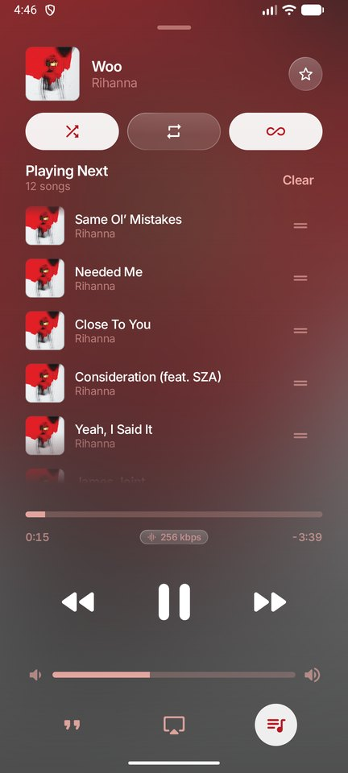
</p>

### 🔎 Browse & search
- Home, New and Radio from your YouTube Music account, with mood chips and pull to refresh.
- **New from Your Artists.** Releases from artists you follow, with a notification.
- Search with filters (songs, albums, artists, playlists) that forgives typos.
- **In Your Library.** Finds your own songs by name **or by a line from their lyrics**.
- Artist pages in the style of iOS 27, plus album and playlist pages.

<p align="center">
  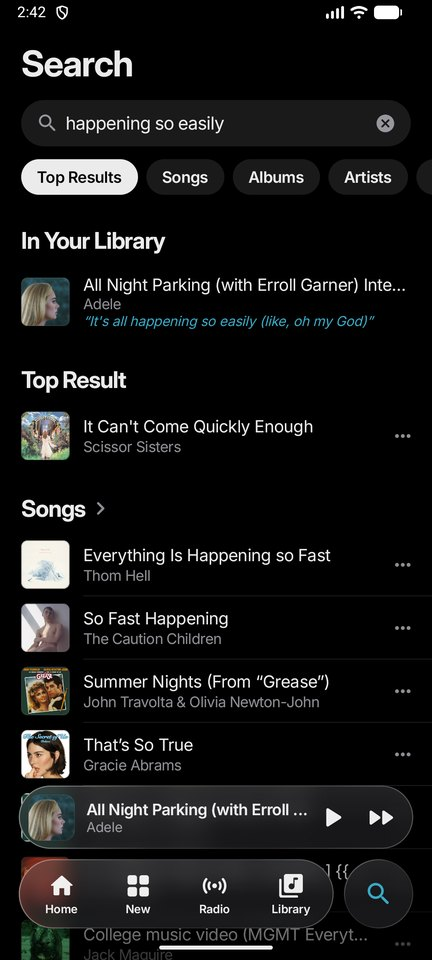
  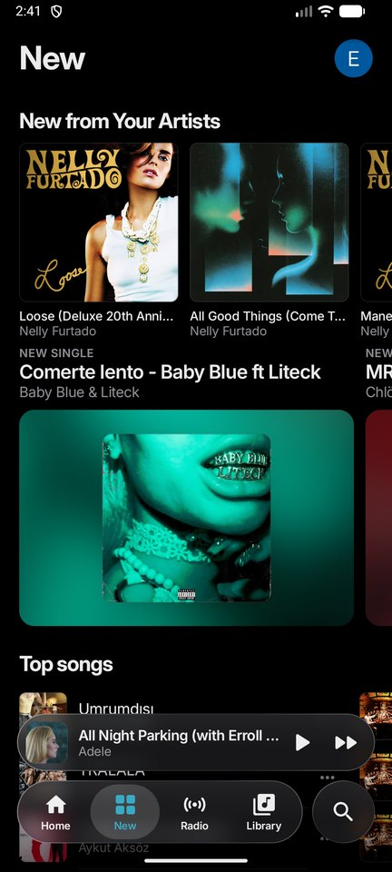
  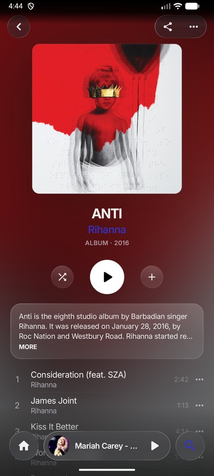
</p>

### 📚 Your library
- Favorites, Recently Played (**all your devices** or just this one), Downloaded and Offline Mix.
- **Smart playlists** that fill themselves: On Repeat, Most Played, Forgotten Favorites,
  Downloaded but Never Played, and a mix for the time of day (morning, afternoon,
  evening, late night).
- **Your own playlists.** Search to add songs, edit or rename, and get suggestions
  that follow what you add.
- Plays sync to your YouTube Music history, so other devices see them too.

<p align="center">
  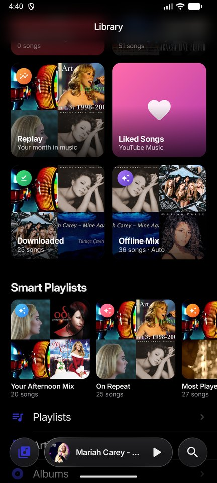
  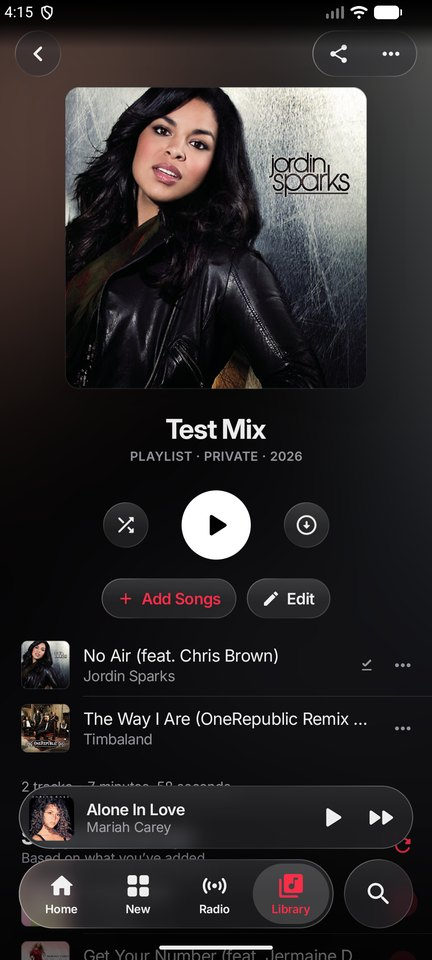
  
</p>

### 📴 Offline that just works
- Downloads, plus a **smart Offline Mix** that keeps your favourite and most-played
  songs downloaded on Wi-Fi.
- A **listening cache**: everything you play is saved as it streams.
- The app **notices when the connection drops**: the song keeps playing and the queue
  switches to music you have offline. When you're back online, your original queue returns.
- Lyrics are saved too, so they show offline.

### 📊 Replay
Your month in minutes, top songs and top artists, played as an **Instagram-style story**
and shareable as an image.

<p align="center">
  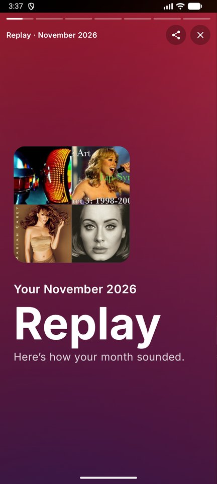
  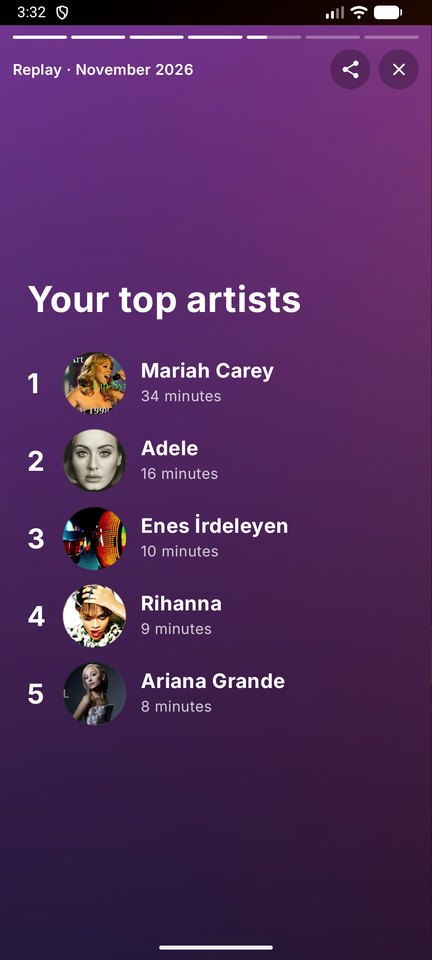
</p>

### 📱 Beyond the app
- **Home screen widgets.** Now Playing, and **live lyrics** that slide line by line.
- **Lyrics on the lock screen** and in the notification.
- **Screen saver while charging.** The cover and the lyrics, with a clock.
- **Android Auto** and "Play … on LiquidTube" from Google Assistant.
- **Resume automatically** when headphones, a speaker or the car connects.

<p align="center">
  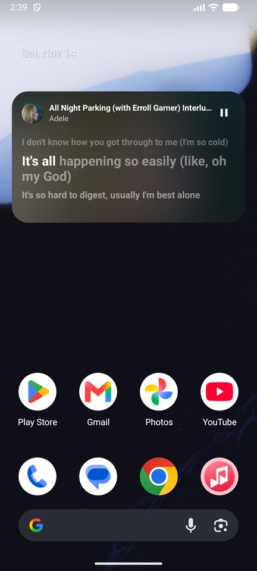
  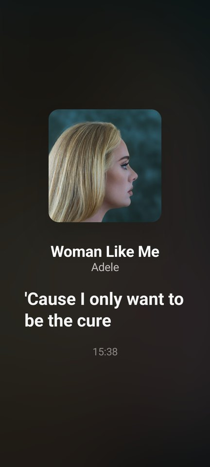
</p>

### 🖥️ Landscape
A side tab rail, and a two-column player: the cover on one side, the controls on the
other. Lyrics and the queue take over the left side.

<p align="center">
  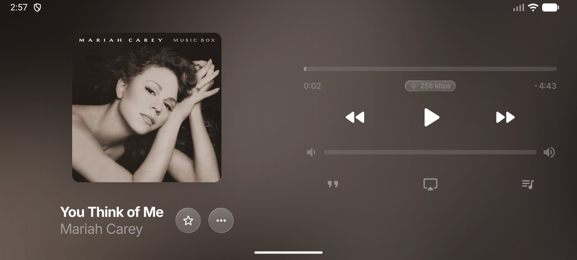
  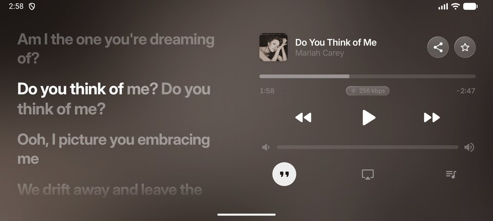
</p>
<p align="center">
  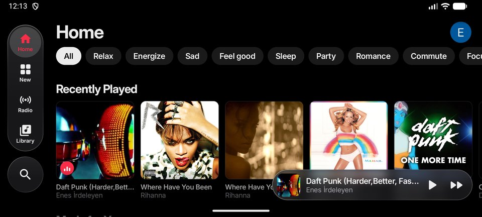
  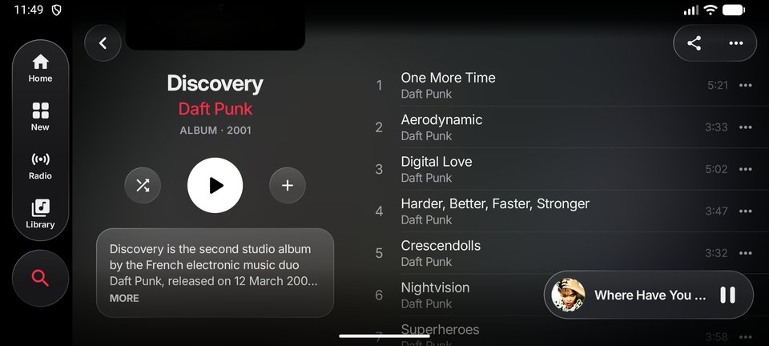
</p>

### 💾 Backup
Daily backup to Google Drive, or a one-off file. A restore brings back your favorites,
stats and settings, and **re-downloads your downloads and Offline Mix**.

---

## 🛠️ Build

- Android Studio (Ladybug or newer), JDK 17
- minSdk 31 (Android 12; needed for the RenderEffect glass blur)
- Build the **release** variant for smooth performance:

```sh
./gradlew :app:assembleRelease
```

## 🗂️ Project layout

| Path | What's inside |
| --- | --- |
| `innertube/` | YouTube Music (InnerTube) API client |
| `app/.../ui/` | Compose screens and the Liquid Glass components |
| `app/.../playback/` | Media3 service, queue logic, lock-screen lyrics, Android Auto |
| `app/.../premium/` | 256 kbps Premium stream support |
| `app/.../download/` | Downloads, Offline Mix, listening cache |
| `app/.../data/` | Settings, library, lyrics, translations, backup, network monitor |
| `app/.../widget/`, `dream/` | Home screen widgets and the screen saver |
